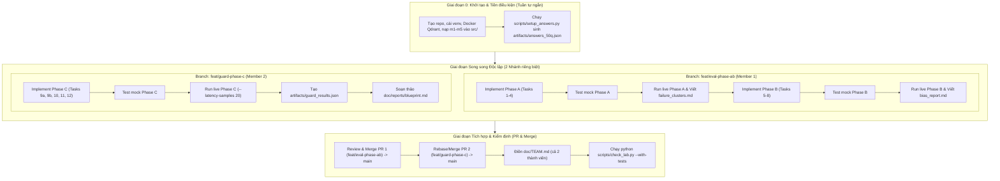

# Kế hoạch Triển khai Chi tiết (Implementation Plan)
## K4 Track 3A — Production Eval + Guardrail Stack

> **Mục tiêu**: Hoàn thành 100/100 điểm bắt buộc + 10/10 điểm bonus (Tổng tối đa 110 điểm).  
> **Mô hình làm việc**: Nhóm 2 người, mỗi người sử dụng 1 AI coding agent (Codex / Antigravity), phát triển song song trên 2 nhánh Git riêng biệt, triệt tiêu xung đột file (zero-conflict by design).

---

## 1. Chiến lược Phân công & Tối ưu Song song

### 1.1 Nguyên tắc thiết kế phân chia (Zero-Conflict Design)
Để 2 kỹ sư và 2 AI agent làm việc song song không bị xung đột mã nguồn và không phải giải thích lại toàn bộ đề bài:
1. **Phân định ranh giới sở hữu file (File Ownership)**:
   - **Member 1 (Evaluation Lead)** sở hữu hoàn toàn:
     - `src/phase_a_ragas.py`
     - `src/phase_b_judge.py`
     - `doc/reports/failure_clusters.md`
     - `doc/reports/bias_report.md`
     - `artifacts/answers_50q.json`, `artifacts/ragas_50q.json`, `artifacts/judge_results.json`
   - **Member 2 (Guardrails & Systems Lead)** sở hữu hoàn toàn:
     - `src/phase_c_guard.py`
     - `doc/reports/blueprint.md`
     - `artifacts/guard_results.json`
   - **File phối hợp chung**: `doc/TEAM.md` (Mỗi thành viên chỉ chỉnh sửa phần INDIVIDUAL của mình và gộp ở bước cuối).

2. **Cân bằng tải theo độ phức tạp kỹ thuật**:
   - **Member 1**: Chịu trách nhiệm về đánh giá chất lượng RAG (RAGAS 4 metrics, ma trận phân cụm lỗi, LLM-as-a-judge với swap-and-average, Cohen's Kappa, position & verbosity bias).
   - **Member 2**: Chịu trách nhiệm về bảo mật và hệ thống (Presidio PII với regex đặc thù Việt Nam, NeMo Guardrails async runtime, adversarial vs clean controls, latency profiling với linear interpolation, và thiết kế toàn diện CI/CD Blueprint).

---

## 2. Sơ đồ Giai đoạn & Luồng thực hiện (Phase Timeline)



---

## 3. Bảng phụ thuộc (Dependency Matrix)

| Giai đoạn | Tác vụ | Phụ thuộc vào | Có thể chạy song song với |
|---|---|---|---|
| **Pre-run** | Setup answers (`answers_50q.json`) | m1-m5, Qdrant, `.env` | Không (phải hoàn tất để lấy answer cho Phase A, B) |
| **Phase A** | Task 1-4 code & tests | Mock dữ liệu | Song song hoàn toàn với Phase C |
| **Phase A Live** | Chạy `run_experiments.py --phase a --live` | `answers_50q.json` | Song song với Phase C Live |
| **Phase B** | Task 5-8 code & tests | Mock dữ liệu | Song song với Phase C |
| **Phase B Live** | Chạy `run_experiments.py --phase b --live` | `answers_50q.json`, `human_labels_10q.json` | Song song với Phase C Live |
| **Phase C** | Task 9a-12 code & tests | Mock dữ liệu trong `fixtures/` | **Song song ngay từ đầu** với Pre-run, Phase A, Phase B |
| **Phase C Live** | Chạy `run_experiments.py --phase c --live` | `guardrails/config.yml`, fixtures | Song song với Phase A Live, Phase B Live |
| **Phase D** | Báo cáo `blueprint.md` | Số liệu latency từ Phase C | Song song với việc viết `bias_report.md` của M1 |
| **Final** | Check Lab & Nộp bài | Cả 2 nhánh đã merge vào `main` | Tuần tự cuối cùng |

---

## 4. Quy trình Git & Phối hợp Nhóm (Git Workflow)

1. **Quy tắc phân nhánh (Branching Model)**:
   - `main`: Nhánh ổn định, được bảo vệ. Không ai commit trực tiếp vào `main`.
   - `feat/eval-phase-ab`: Nhánh làm việc của Member 1.
   - `feat/guard-phase-c`: Nhánh làm việc của Member 2.
2. **Quy ước Commit**:
   - Cấu trúc: `feat(<task-id>): <nội dung ngắn gọn> - [Member X]`
   - Ví dụ: `feat(Task-1): implement group_by_distribution with exact counts - [Member 1]`
3. **Quy trình Merge & Review**:
   - Member 1 hoàn thành Phase A + B $\rightarrow$ Tạo PR #1 vào `main`. Member 2 review code $\rightarrow$ Merge.
   - Member 2 hoàn thành Phase C + Blueprint $\rightarrow$ Tạo PR #2 vào `main` (kéo các thay đổi mới nhất từ `main` về nếu cần) $\rightarrow$ Member 1 review $\rightarrow$ Merge.
   - Cả 2 cùng cập nhật `doc/TEAM.md` qua PR chung cuối cùng hoặc commit của Trưởng nhóm.
4. **Cam kết an toàn tuyệt đối**:
   - Tuyệt đối không dùng `git push --force` đè lên nhánh của nhau.
   - Không commit file `.env`, API keys, hoặc thư mục virtualenv. Kiểm tra bằng:
     ```bash
     git check-ignore artifacts/answers_50q.json artifacts/ragas_50q.json artifacts/judge_results.json artifacts/guard_results.json
     ```
